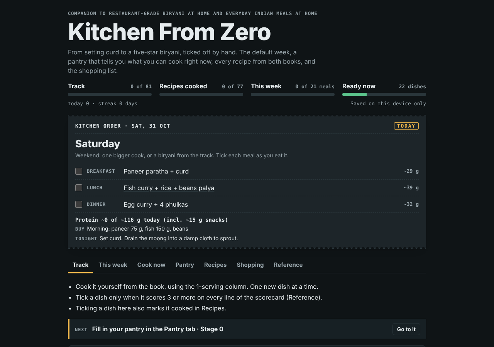
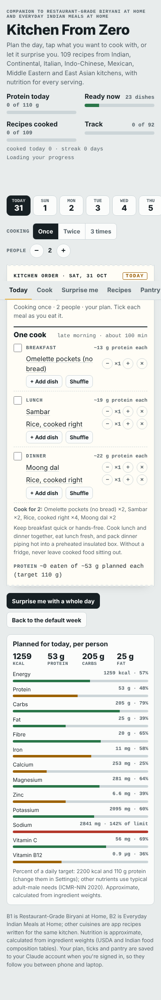
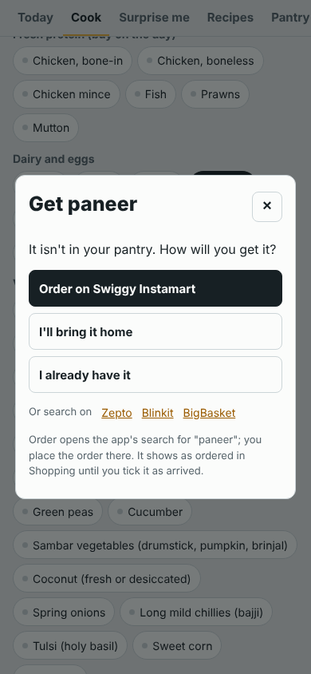
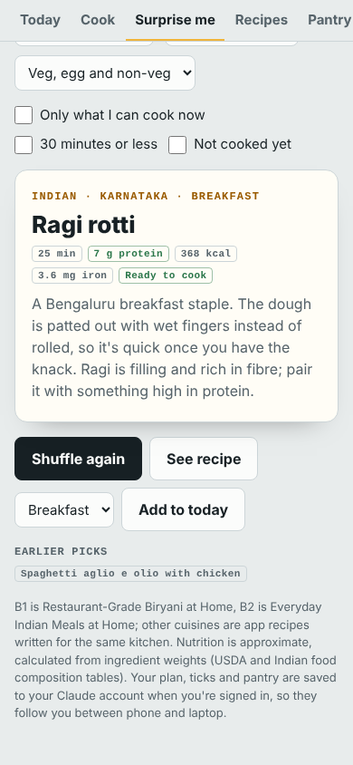
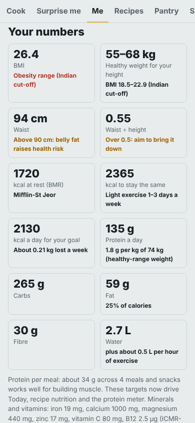
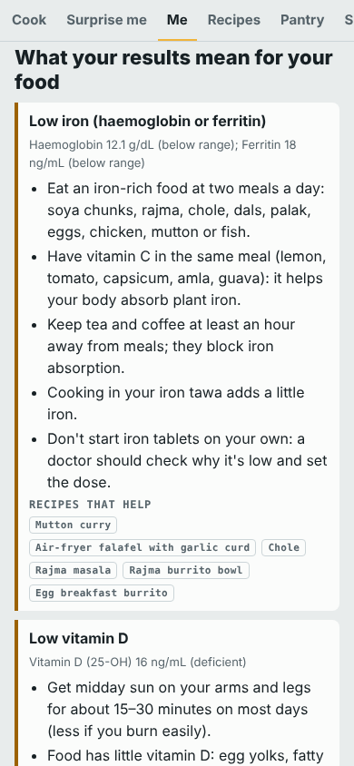
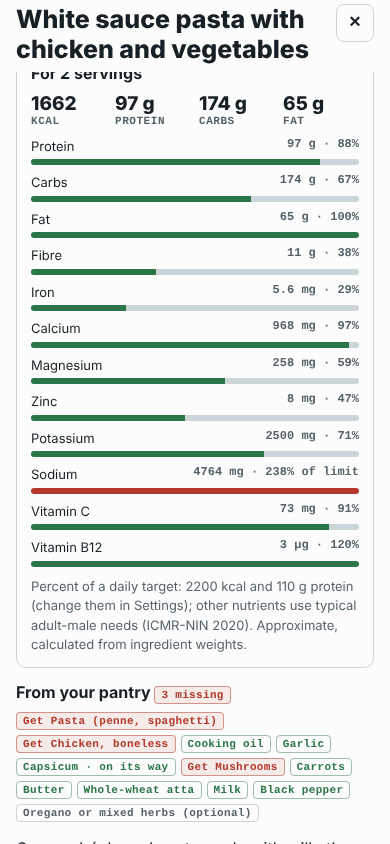

# Kitchen From Zero

See the [product audit and architecture roadmap](docs/PRODUCT-ARCHITECTURE-PLAN.html) for the proposed next phases.

## Android app

Install **[KitchenFromZero.apk](https://github.com/manojhunasimarad/Kitchen/raw/apk/KitchenFromZero.apk)** on your phone
(allow "Install unknown apps" for your browser or Files app when Android asks). The app opens this website, so every fix
published here reaches the app without reinstalling. It works offline after the first open; if the phone has never been
online with it, a copy bundled in the APK is used. Grocery "Order" links open the shop's own app, Share list and
Download backup use Android's share sheet and Downloads folder, the back button closes sheets first, and the screen
stays on while a recipe is open.

Data saved in the app is separate from data saved in Chrome. Move it with Settings → *Copy my data* on one and
*Replace my data with this* on the other.

The APK is built by `.github/workflows/android.yml` from `android/` and published on the `apk` branch. Without
signing secrets it is signed with the build machine's temporary key, so installing a newer APK may require uninstalling
the old one first (back up your data before you do). To sign every build with the same key, create a keystore once and
add the repository secrets `ANDROID_KEYSTORE_B64` (the keystore, base64-encoded), `ANDROID_KEYSTORE_PASSWORD`,
`ANDROID_KEY_ALIAS` and `ANDROID_KEY_PASSWORD`.

## Prep ahead, batch prep and the fridge switch

Today opens with a **Prep ahead** card covering the next four days of the plan: soaking (rajma, chole, kala chana,
alasande, sabudana, neer dosa rice…), sprouting (moong, matki), marinating, resting dough and setting curd. Each task
shows the scaled amount ("Soak 300 g rajma in about 1.2 L water for 8–10 hours"), which meal it is for, a suggested
start time that avoids 23:00–06:30 (before bed or first thing in the morning), the safe window, a tick box, and an
⏰ Clock alarm (Android) or Google Calendar reminder (web). A step that is already too late says so, gives the quick
fix where one is safe (quick-soak for beans) and offers a one-tap swap. The evening pantry-check notification also
mentions tonight's prep. Lead times live in `data/advance_prep.json` and are checked against the recipes by
`tests/test_prep_ahead.py`.

The **Fridge** switch (Working · Off till tomorrow · Off 2 days · Off) changes the advice: with the fridge off,
marinades are capped at 2 hours, no batch cooking for later days, and a short list of what is safe to do instead;
when it comes back on that date, **Batch and prep ideas** adds up what the next three days share (ginger-garlic
paste, chopped onions, cooked beans, chapati dough, tamarind extract, roasted rava and peanuts) with total grams,
how long each keeps and how to make it (`data/batch_prep.json`).

Recipes now open with **Before you start**: what to do ahead at the servings shown, a "get these ready" list with
gram weights for onions and tomatoes, and the time. Ingredient amounts round to what you can measure (bay leaves and
cloves grow slowly, pinches become teaspoons, 3¾ tsp becomes 1¼ tbsp), amounts inside the method scale with
servings and are highlighted, and each step with a time has a ⏱ timer. Biryani variations show their master
recipe's full method. **Ask Claude about this recipe** (and *Ask Claude* in Kitchen AI) opens a new Claude chat
with the scaled recipe, plan, prep list and pantry filled in, and copies the same text; nothing is sent until you
press send. Kitchen AI (Gemini) now gets the same scaled recipe and prep list and is told to answer with grams,
flame, minutes and doneness cues.

## Phone layout, dark mode and the Today planner

A top bar shows the current section with search and an appearance button; the menu lists every section, grouped
as Plan, Cook, Stock and You (on wide screens it stays open as a sidebar). On phones a bottom bar also gives one-tap
access to Today, Cook, Recipes, Shopping and the menu. Appearance switches between Auto, Light and Dark; Auto follows
the phone. Each day has its own menu,
Shuffle and Surprise pick random dishes for the people eating, ⟳ swaps one dish, and missing ingredients,
night-before prep and per-person nutrition update as you change the plan.

How often you cook changes the menu, not just the grouping. **Three times:** everything is cooked fresh, so the full
weekly menu applies. **Twice:** breakfast and the lunch box are made together in the morning, so breakfast is swapped
for one ready within 30 minutes and lunch for a dish that packs well; dinner is fresh. **Once:** breakfast is ready
in 20 minutes with no soaking, and lunch and dinner come from one pot, so the morning cooking amounts are doubled and
there is one batch to cook instead of two. Each cooking session lists what to cook and how many servings. A day you
haven't edited switches to that mode's default menu; a day you have edited keeps your dishes and only swaps the ones
that don't fit.

**Prep skills** (in the menu) explains using the pull-cord hand chopper (how many pulls for coarse, fine or purée),
chopping and slicing onions, peeling and mincing garlic, peeling ginger with a spoon, getting corn off the cob, and
handling herbs and green chillies, each with sources. Recipes show **Prep help** links to the guides they need.

## Cooking now, today, tomorrow or on a chosen day

**Cooking for: Now · Today · Tomorrow** sits above the cooking-times switch on Today. **Now** leaves out meals whose
time has passed (30 minutes after the eating time), and for what's left swaps any dish that won't be ready in time
or needs something missing from the pantry for a similar one that fits (same diet, same cuisine where possible); a
note lists every swap. After the last meal of the day, Now shows tomorrow and tonight's soaking. **Tomorrow** shows
tomorrow's plan with tonight's prep. Any other day is one tap on the date strip.

To decide a dish yourself, open it and use **Cook this**: pick the day (today to a week ahead), the meal and whether it
goes **instead of that meal's main** (rice or rotis are added or dropped to suit it) or **alongside**. Servings,
shopping, night-before soaking and the cooking sessions update, and the dish is pinned so changing how often you cook
won't swap it. Ragi mudde, bhatura, poori and holige bring their usual partner (saaru or chole).

Switching **Once / Twice / 3 times** is reversible: your own breakfast and dinner come back when you switch back, and a
note says what changed. **Cook … every day** makes the current choice the default for days you haven't changed.

Regional additions: Andhra/Telangana variety rices (capsicum, sweet corn, tomato, pulihora, kobbari annam, pudina,
carrot), pachi pulusu and pesarattu; Karnataka ragi mudde, akki rotti, neer dosa, uppittu, ragi ambali (ganji), bele
holige, kattina saaru, North Karnataka madli and Muharram chonge; Maharashtrian misal; Kerala avial; poori and atta bhatura.

## Pantry check, use-it-first and budget mode

Twice a day (08:00 and 19:30 by default; change in Settings) the Android app shows a **Pantry check** notification.
Tap it, or the card at the top of Today, to tick Have, Low or Out for fresh food and for what today's and tomorrow's
meals need. The app records when fresh items arrive (when they go from Out to Have) and lists them under **Use these
first** as they approach their usual fridge life, with dishes you can cook from them. Fridge times come from
FoodSafety.gov and university extension charts (`data/shelf_life.json`) and are guidance only. Settings can also add
the times as daily alarms in the phone's Clock app, or as Google Calendar reminders on the website.
**Budget mode** makes Shuffle, Surprise and swaps avoid dishes that need a pricey item you don't have; the pricey list
is editable and those items are marked ₹ in Shopping.

## Food rules

The collection never uses beef, pork (bacon, ham, lard, sausages and similar), gelatine or alcohol in cooking;
`tests/test_kitchen.py` fails the build if any recipe or quick add-on mentions them, and checks that dishes labelled
vegetarian or egg don't need meat, fish or (for vegetarian) eggs. Non-vegetarian dishes use chicken, mutton, fish and
prawns only. Cheese recipes note that strict vegetarians should pick cheese marked with the green vegetarian dot.

Source-compared additions (November 2026): cheese corn balls (air fryer or fried, with a tip for leftover corn-cheese
sandwich filling), corn cheese sandwich, butter garlic sweet corn and garlic bread on a tawa or in the air fryer,
each compared with at least two of Hebbar's Kitchen, Dassana's Veg Recipes, Cook with Kushi, Swasthi's Recipes,
Tarla Dalal, Ranveer Brar and RecipeTin Eats. They are not kitchen-tested.

## Household and regional recipes

The Today planner now supports five members (two vegetarian, one eggetarian, two non-vegetarian),
attendance/portions/eating times for each meal, dish recipients, per-person nutrition estimates,
and quantities based on those recipients. Settings includes two cooks, four stove burners,
one induction, one air fryer, one sandwich maker, a fridge and 3 L + 5 L pressure cookers.
Mixer availability still needs confirmation. See [the household guide](docs/HOUSEHOLD.md).

Four source-compared regional adaptations add yennegai, khara pongal, Kesari Bath and cabbage
pakoda. Their method amounts scale with servings; their sources, variant differences and
unmeasured timing ranges are explicit. They are not labelled kitchen-tested.

## Kitchen AI (free Gemini key)

Tap the ✨ button in the top bar, **Ask Kitchen AI** in the menu, or **Ask AI about this recipe** inside a recipe.
The first time, it asks for a free Google Gemini API key: open <https://aistudio.google.com/apikey>, sign in,
tap **Create API key** and paste it. Don't add billing to that Google project, so it can never charge you.

- **Ask anything**: "What can I cook now?", "Use what's getting old", "Plan tomorrow", "The gravy is too watery".
  Each question sends your pantry (Have / Low / use-first), the household diets and a compact list of the app's
  recipes with what each is missing, so answers point to real recipes (tap the chips to open them).
- **Pantry photo**: photograph a shelf, fridge or grocery bag. The AI lists pantry items it can see; you untick
  mistakes and nothing changes until you tap save.
- **Rules**: cooking topics only, no beef or pork, diets respected, no invented quantities, cautious food-safety
  answers. AI can still be wrong; the recipe text stays the reference.
- **Privacy**: the key is kept only in that phone's or browser's local storage. It is not part of the synced state,
  backups or this repository. On the free tier Google may use what you send to improve its products.
- **Model**: it uses the `gemini-flash-latest` alias, and if Google retires that it picks the newest available
  Flash model for your key automatically.
- **Android**: the photo button needs APK build 6 or later (it adds the file picker).

## Local reliability and cooking preview

The local update adds tested fractional scaling, received-stock availability, visible save failures,
downloadable backups, direct recipe links, cooking step checkboxes, a mobile section selector,
and preparation metadata for 12 pilot recipes. Nutrition is collapsed below the method.

Run `python -X utf8 tools/serve.py` (or `./Start-Local.ps1` on Windows), then open the printed local URL.
Run `python -X utf8 tools/evaluate.py` for repeatable engineering checks. See
[local development instructions](docs/LOCAL-DEVELOPMENT.md) for the build, optional local-model
adapter, data migration limits and tests.

The optional assistant currently retrieves recipe evidence; it does not invent missing cooking
instructions. No model is installed or trained. Recipes and times have not been certified by
kitchen trials. The descriptions below document the original feature set; the local development
guide records current limitations and the next implementation phases.

A phone-first planner customized for a five-person household: two cooks, two stoves with four burners, induction, 3 L and 5 L pressure cookers, an air fryer, a sandwich maker and a fridge. It started as a companion to two home cookbooks, *Restaurant-Grade Biryani at Home* (Book 1) and *Everyday Indian Meals at Home* (Book 2), and adds 32 recipes from other cuisines written for the same kitchen.

159 recipes across seven cuisines: Indian, Continental, Italian, Indo-Chinese, Mexican, Middle Eastern and East Asian. Every serving has its nutrition worked out.



## What's in it

| Tab | What it does |
| --- | --- |
| **Today** | The day as a kitchen order slip, for any of the next 7 days. Choose whether you cook **once, twice or three times** and for **how many people**. Meals are grouped into cooking sessions, with combined quantities, cooking time, missing items and food-safety notes for a kitchen without a fridge. Add, remove, scale or **shuffle** dishes, or let it plan the whole day. Nutrition for the day is shown against your targets. |
| **Cook** | Tap the ingredients you want to cook with. When one isn't in your pantry, it asks whether to **order it** (opens Swiggy Instamart, Zepto, Blinkit or BigBasket search) or **bring it home**. Dishes from every cuisine that use your picks are listed as ready, one item short or two short. |
| **Surprise me** | Shuffles a random dish that matches your filters: meal, cuisine, diet, only what you can cook now, 30 minutes or less, not cooked yet. Add it to today with one tap. |
| **Me** | Your profile (name, sex, age, height, weight, waist, activity, training days, goal) and a **diet calculator**: BMI and waist with Indian cut-offs, BMR (Mifflin-St Jeor), maintenance calories, a calorie target for your goal, protein (1.2–2.0 g/kg of a healthy-range weight), carbs, fat, fibre, water, and vitamin and mineral needs by sex and age (ICMR-NIN 2020). These targets drive the rest of the app. Also a **weight log** with a trend line, **blood tests** (haemoglobin, ferritin, vitamin D, B12, glucose, HbA1c, cholesterol, triglycerides, TSH, uric acid, creatinine, zinc) with typical ranges you can replace with your lab's, food advice and recipes for anything out of range, and a **hair-fall guide** that checks your plan and results and rates common remedies by evidence. |
| **Recipes** | All recipes, searchable and sortable by protein, iron, calories or time. Each recipe has a **servings** control that rescales the ingredients and nutrition, plus "Add to plan" and the full method. |
| **Pantry** | 108 staples, each marked Have, Low or Out. |
| **Shopping** | Items your plan needs today and tomorrow (with Order and Bring buttons), what you're bringing home, what's on order, and what's running low. *Copy list* puts the list on the clipboard. |
| **Track** | 15 stages and 92 tick-offs, from setting curd to the master biryanis and a World kitchen stage. |
| **Reference** | How the recipes were checked (with sources), daily targets, the five-star scorecard, cooker and air-fryer charts, what keeps without a fridge, food safety, flavour jars and ready-mix masalas. |
| **Settings** | Default people and cooking sessions, your order app, and an option to set your own calorie and protein targets instead of the calculator's. |

<p>
  
  
  
</p>

<p>
  
  
</p>

## Historical recipe-checking claims

The following describes the original 109-recipe version. It is not certification of the current collection. Current external-review scopes are attached to individual recipes; no kitchen trials have been recorded.

- **Against the books:** all 77 book recipes were compared line by line with the two PDFs (ingredient names, quantities, method text). They match. The Book 1 variations and sides are correctly halved from the book's 2-serving amounts. Eight ingredient rows the book has but the app had left out were added.
- **Consistency and food safety:** all 109 recipes were checked automatically for ingredients missing from the list or never used, salt per serving, air-fryer temperatures, marinating longer than 2 hours without a fridge, doneness checks, rice and rajma safety, and leftovers.
- **Against published sources:** cooker whistles, soaking, par-boiling, dum, air-fryer settings and safe temperatures were compared with published recipes and food-safety guidance. Fixes: chicken fried rice (rice now fried within 2 hours of cooking), egg pasta (sauce thickened to about 70 °C), Thai red curry (Thai basil, not tulsi), falafel timing, doneness checks on six chicken recipes, and less salt in three recipes.

The books were written in the same chat as the app, so the published-source checks are the independent part. The full table, with links, is in the app under Reference. Figures remain approximate.

## Health features

The calculator, blood-test ranges and hair-fall guide are general information, not a diagnosis. Your report's reference ranges and your doctor's advice come first. Values far out of range are flagged "see a doctor soon". When the page is used through a Claude account, the profile and results are stored in that account's private space.

## Nutrition

Each recipe's nutrition comes from its ingredient weights. The nutrients are energy, protein, carbs, fat, fibre, iron, calcium, magnesium, zinc, potassium, sodium, vitamin C and vitamin B12. The values per 100 g come from USDA FoodData Central and the Indian Food Composition Tables (IFCT 2017), rounded, in `tools/nutrition.py`. Book recipes have their quantities ("½ tbsp", "1 medium onion", "a pinch") converted to grams by rules in the same file. The new recipes give grams directly. Treat all figures as approximate.

Daily targets: calories and protein are yours to set (defaults 2200 kcal and 110 g). The rest use typical adult-male needs from ICMR-NIN 2020, with sodium as an upper limit.



## Using it

**Website (works offline):** https://manojhunasimarad.github.io/Kitchen/ · **Android app:** see above

Open it once with internet and it saves itself on the device. After that it opens with no connection: everything works except the grocery-app Order links. To use it like an app:

- **Android (Chrome):** menu ⋮ → *Add to Home screen* or *Install app*.
- **iPhone (Safari):** Share → *Add to Home Screen*.

When you're online it picks up new versions automatically. On the website, your plan, pantry, profile and results are saved in that browser on that device.

**Synced across devices:** published as a Claude artifact, the same page saves to your Claude account, so phone and laptop stay in step (this needs internet).

**Moving data between them:** Settings → *Move your data*. Tap *Copy my data* on one copy, paste it into the other and tap *Replace my data with this*.

"Order" only opens the grocery app's search for the item. You place the order in the app, and the item shows as ordered in Shopping until you tick it as arrived.

## Editing and rebuilding

The page is built from data, so you don't edit `index.html` by hand.

```
src/template.html        layout, styles and app logic (/*DATA*/ is replaced at build time)
data/b2_cards.json       Book 2 recipe cards, extracted from the PDF
data/b1_masters.json     Book 1 master biryanis, extracted from the PDF
data/data.json           the combined app data
tools/world_recipes.py   the 32 recipes from other cuisines (with grams) and quick add-ons like a glass of milk
tools/book1_extra.py     Book 1 variations and sides
tools/nutrition.py       nutrients per 100 g, the gram converter and the ingredient-name rules
tools/build_data.py      pantry, matching rules, cuisine and course, nutrition, track, default week, targets, order apps
tools/build_page.py      embeds data/data.json into the template; writes index.html (website, offline-ready)
                         and dist/artifact.html (the Claude artifact version), and bumps the cache name in sw.js
sw.js, manifest.webmanifest, icons/   offline support and home-screen install for the website
tools/extract_b1.py      re-extracts Book 1 from the PDF (needs pdfplumber)
tools/extract_b2.py      re-extracts Book 2 from the PDF (needs pdfplumber)
```

```bash
python3 tools/build_data.py
python3 tools/build_page.py
```

To add a recipe, append an entry to `WORLD` in `tools/world_recipes.py`. Give each ingredient a pantry or nutrition key, a display quantity and its weight in grams, then rebuild.

To re-extract from the books, put the PDFs in `books/` (git-ignored) or pass their paths:

```bash
pip install pdfplumber
python3 tools/extract_b2.py books/Everyday_Indian_Meals_at_Home.pdf
python3 tools/extract_b1.py books/Restaurant_Grade_Biryani_at_Home.pdf
```

## Notes

- Page references (`B1 p. 18`, `B2 p. 37`) point to the PDFs. Protein figures in the app are calculated from ingredients, so they can differ a little from the books.
- The food-safety notes follow the books: without a fridge, eat cooked food within 2 hours, or pack it piping hot into a preheated insulated box. Never keep cooked rice overnight.
- Book 1, page 34: the heading of the five-person party biryani is missing its fraction symbols in the PDF. It should read "two-thirds chicken, one-third paneer".
