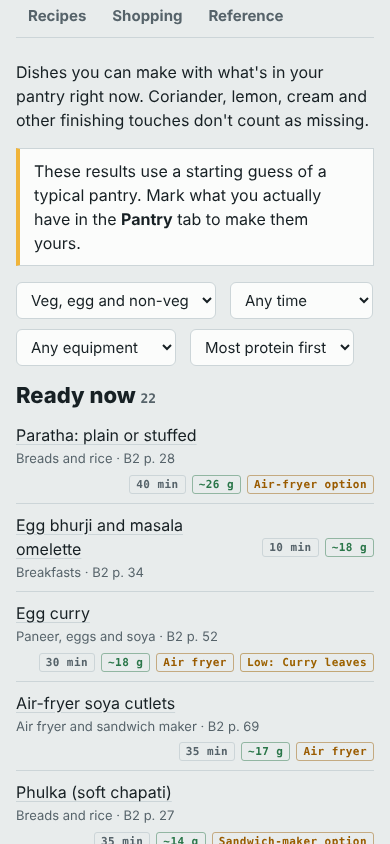
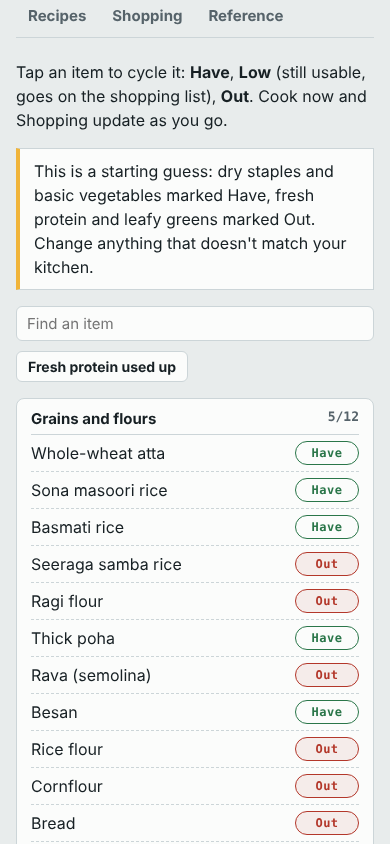
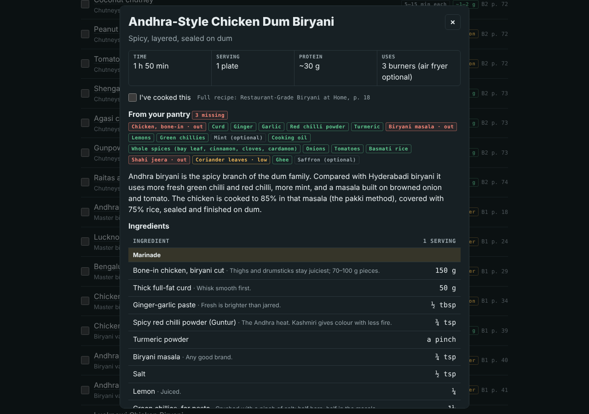

# Kitchen From Zero

A single-page kitchen tracker for two home cookbooks: *Restaurant-Grade Biryani at Home* (Book 1) and *Everyday Indian Meals at Home* (Book 2). It's built for one person cooking in a small Indian kitchen with no fridge or oven, using two stoves, a pressure cooker, an air fryer and a sandwich maker.

It works like a learning track. You move from setting curd to a five-star biryani in stages, tick off each dish as you master it, and the progress bars fill up.


## What's in it

| Tab | What it does |
| --- | --- |
| **Today** (top of page) | Today's breakfast, lunch and dinner from the default week, laid out like a kitchen order slip. Tick each meal as you eat it to see protein so far, what to buy today and what to prep tonight. |
| **Track** | 14 stages and 81 tick-offs, from kitchen basics through dals, breads, curries, air fryer and sandwich maker, up to the master biryanis and the hotel finish. A *Next* box takes you to the first thing you haven't ticked. |
| **This week** | The seven-day default menu (about 88–118 g protein a day), with buying lists and night-before tasks. Ticks reset every Monday. |
| **Cook now** | Every recipe sorted into *ready now*, *one item short* and *two items short* based on your pantry. Filter by diet, time or appliance. |
| **Pantry** | 94 staples. Tap an item to mark it Have, Low or Out. |
| **Recipes** | All 77 recipes from both books, searchable. Each opens with the 1-serving ingredients, method, tips, variations and the book page number. |
| **Shopping** | Fresh items to buy today and tomorrow, plus anything low or out that a meal later this week needs. Ticking an item you've bought marks it Have in the pantry. *Copy list* puts the list on the clipboard. |
| **Reference** | The five-star scorecard, pressure-cooker whistle chart, air-fryer settings, what keeps without a fridge, food safety, protein boosters, three flavour-jar blends and ready-mix masala brands. |

<p>
  
  
</p>



## Using it

Open `index.html` in any browser. It's one self-contained file that works offline. The fonts fall back to system fonts when you're offline.

To put it online with GitHub Pages: in **Settings → Pages**, choose *Deploy from a branch*, then `main` and `/ (root)`. It will be served at `https://<user>.github.io/kitchen/`.

**Where progress is saved:** opened as a file or from GitHub Pages, your ticks and pantry are saved in that browser (`localStorage`), so they stay on that device. Published as a Claude artifact, the same page also saves to your Claude account when you're signed in, so progress follows you across devices.

## Editing recipes and rebuilding

The page is built from data, so you don't edit `index.html` by hand.

```
src/template.html       page layout, styles and app logic (the /*DATA*/ marker is replaced at build time)
data/b2_cards.json      Book 2 recipe cards, extracted from the PDF
data/b1_masters.json    Book 1 master biryanis, extracted from the PDF
data/data.json          the combined app data (recipes, pantry, track, week, reference)
tools/book1_extra.py    Book 1 variations and sides, written out by hand
tools/build_data.py     merges everything into data/data.json: pantry list, ingredient-matching rules,
                        track stages, default week and reference tables
tools/build_page.py     embeds data/data.json into the template and writes index.html
tools/extract_b1.py     re-extracts Book 1 from the PDF (needs pdfplumber)
tools/extract_b2.py     re-extracts Book 2 from the PDF (needs pdfplumber)
```

After editing `tools/build_data.py`, `tools/book1_extra.py` or `src/template.html`:

```bash
python3 tools/build_data.py
python3 tools/build_page.py
```

To re-extract from the books, put the PDFs in `books/` (it's git-ignored, so the books stay out of the repo) or pass their paths:

```bash
pip install pdfplumber
python3 tools/extract_b2.py books/Everyday_Indian_Meals_at_Home.pdf
python3 tools/extract_b1.py books/Restaurant_Grade_Biryani_at_Home.pdf
```

### How "Cook now" decides what you can make

`build_data.py` scans each recipe's ingredient names with keyword rules and maps them to pantry keys (for example `chicken`, `curd`, `garam`). Alternatives become *either-or* needs, such as `oil|butter`. Finishing touches like coriander, lemon, cream, kasuri methi and saffron are left out of the strict check, so they never block a dish. Fixes for individual recipes go in `OVERRIDE_NEEDS` and `OVERRIDE_STRICT`.

## Notes

- Page references (`B1 p. 18`, `B2 p. 37`) point to the PDFs. Protein figures are approximate.
- Book 1, page 34: the heading of the five-person party biryani is missing its fraction symbols in the PDF. It should read "two-thirds chicken, one-third paneer". The app shows it correctly.
