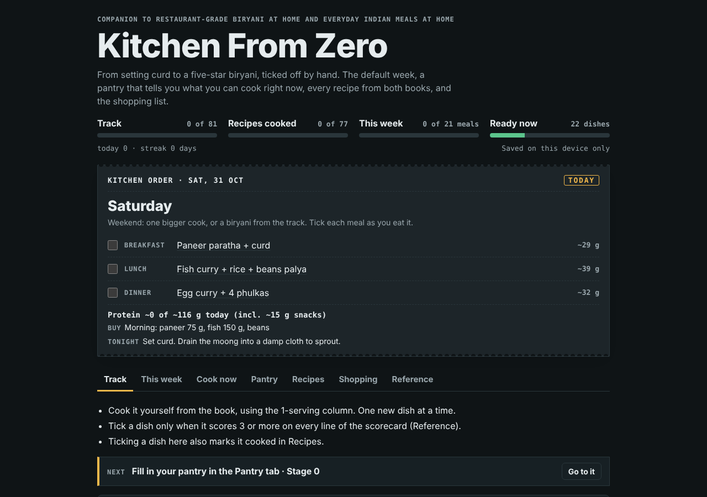
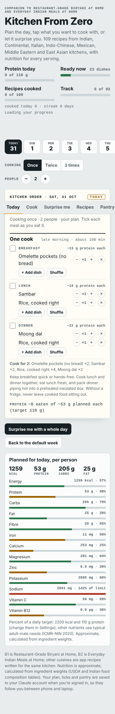
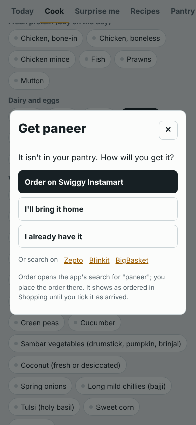
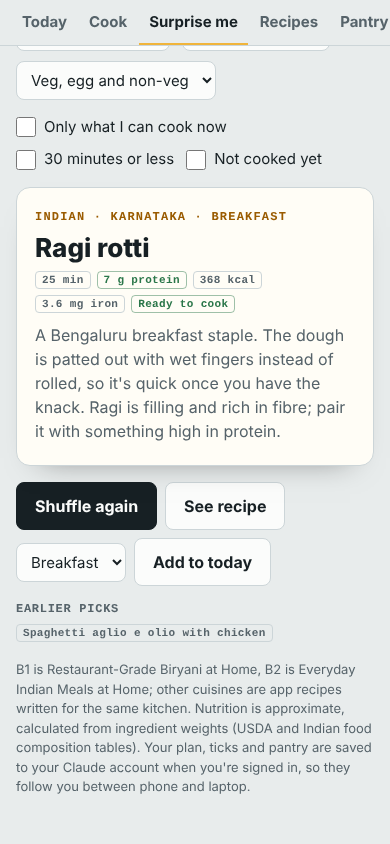
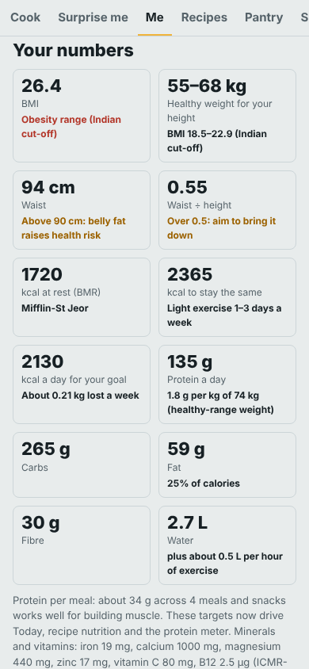
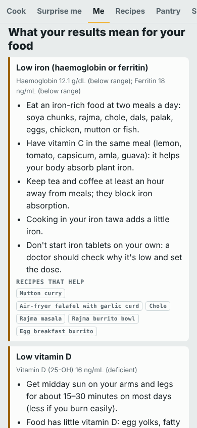
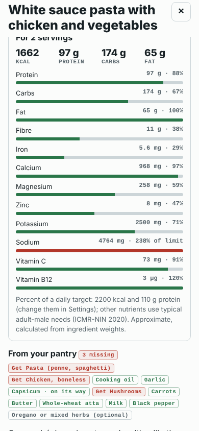

# Kitchen From Zero

A phone-first kitchen planner for a small kitchen with no fridge or oven: two stoves, a pressure cooker, an air fryer and a sandwich maker. It started as a companion to two home cookbooks, *Restaurant-Grade Biryani at Home* (Book 1) and *Everyday Indian Meals at Home* (Book 2), and adds 32 recipes from other cuisines written for the same kitchen.

109 recipes across seven cuisines: Indian, Continental, Italian, Indo-Chinese, Mexican, Middle Eastern and East Asian. Every serving has its nutrition worked out.



## What's in it

| Tab | What it does |
| --- | --- |
| **Today** | The day as a kitchen order slip, for any of the next 7 days. Choose whether you cook **once, twice or three times** and for **how many people**. Meals are grouped into cooking sessions, with combined quantities, cooking time, missing items and food-safety notes for a kitchen without a fridge. Add, remove, scale or **shuffle** dishes, or let it plan the whole day. Nutrition for the day is shown against your targets. |
| **Cook** | Tap the ingredients you want to cook with. When one isn't in your pantry, it asks whether to **order it** (opens Swiggy Instamart, Zepto, Blinkit or BigBasket search) or **bring it home**. Dishes from every cuisine that use your picks are listed as ready, one item short or two short. |
| **Surprise me** | Shuffles a random dish that matches your filters: meal, cuisine, diet, only what you can cook now, 30 minutes or less, not cooked yet. Add it to today with one tap. |
| **Me** | Your profile (name, sex, age, height, weight, waist, activity, training days, goal) and a **diet calculator**: BMI and waist with Indian cut-offs, BMR (Mifflin-St Jeor), maintenance calories, a calorie target for your goal, protein (1.2–2.0 g/kg of a healthy-range weight), carbs, fat, fibre, water, and vitamin and mineral needs by sex and age (ICMR-NIN 2020). These targets drive the rest of the app. Also a **weight log** with a trend line, **blood tests** (haemoglobin, ferritin, vitamin D, B12, glucose, HbA1c, cholesterol, triglycerides, TSH, uric acid, creatinine, zinc) with typical ranges you can replace with your lab's, food advice and recipes for anything out of range, and a **hair-fall guide** that checks your plan and results and rates common remedies by evidence. |
| **Recipes** | All 109 recipes, searchable and sortable by protein, iron, calories or time. Each recipe has a **servings** control that rescales the ingredients and nutrition, plus "Add to plan" and the full method. |
| **Pantry** | 108 staples, each marked Have, Low or Out. |
| **Shopping** | Items your plan needs today and tomorrow (with Order and Bring buttons), what you're bringing home, what's on order, and what's running low. *Copy list* puts the list on the clipboard. |
| **Track** | 15 stages and 92 tick-offs, from setting curd to the master biryanis and a World kitchen stage. |
| **Reference** | How the recipes were checked (with sources), daily targets, the five-star scorecard, cooker and air-fryer charts, what keeps without a fridge, food safety, flavour jars and ready-mix masalas. |
| **Settings** | Default people and cooking sessions, your order app, and an option to set your own calorie and protein targets instead of the calculator's. |

<p>
  
  
  
</p>

<p>
  
  
</p>

## How the recipes were checked

- **Against the books:** all 77 book recipes were compared line by line with the two PDFs (ingredient names, quantities, method text). They match. The Book 1 variations and sides are correctly halved from the book's 2-serving amounts. Eight ingredient rows the book has but the app had left out were added.
- **Consistency and food safety:** all 109 recipes were checked automatically for ingredients missing from the list or never used, salt per serving, air-fryer temperatures, marinating longer than 2 hours without a fridge, doneness checks, rice and rajma safety, and leftovers.
- **Against published sources:** cooker whistles, soaking, par-boiling, dum, air-fryer settings and safe temperatures were compared with published recipes and food-safety guidance. Fixes: chicken fried rice (rice now fried within 2 hours of cooking), egg pasta (sauce thickened to about 70 °C), Thai red curry (Thai basil, not tulsi), falafel timing, doneness checks on six chicken recipes, and less salt in three recipes.

The books were written in the same chat as the app, so the published-source checks are the independent part. The full table, with links, is in the app under Reference. Figures remain approximate.

## Health features

The calculator, blood-test ranges and hair-fall guide are general information, not a diagnosis. Your report's reference ranges and your doctor's advice come first. Values far out of range are flagged "see a doctor soon". When the page is used through a Claude account, the profile and results are stored in that account's private space.

## Nutrition

Each recipe's nutrition comes from its ingredient weights. The nutrients are energy, protein, carbs, fat, fibre, iron, calcium, magnesium, zinc, potassium, sodium, vitamin C and vitamin B12. The values per 100 g come from USDA FoodData Central and the Indian Food Composition Tables (IFCT 2017), rounded, in `tools/nutrition.py`. Book recipes have their quantities ("½ tbsp", "1 medium onion", "a pinch") converted to grams by rules in the same file. The new recipes give grams directly. Treat all figures as approximate.

Daily targets: calories and protein are yours to set (defaults 2200 kcal and 110 g). The rest use typical adult-male needs from ICMR-NIN 2020, with sodium as an upper limit.



## Using it

**Website (works offline):** https://manojhunasimarad.github.io/Kitchen/

Open it once with internet and it saves itself on the device. After that it opens with no connection: everything works except the grocery-app Order links. To use it like an app:

- **Android (Chrome):** menu ⋮ → *Add to Home screen* or *Install app*.
- **iPhone (Safari):** Share → *Add to Home Screen*.

When you're online it picks up new versions automatically. On the website, your plan, pantry, profile and results are saved in that browser on that device.

**Synced across devices:** published as a Claude artifact, the same page saves to your Claude account, so phone and laptop stay in step (this needs internet).

**Moving data between them:** Settings → *Move your data*. Tap *Copy my data* on one copy, paste it into the other and tap *Replace my data with this*.

"Order" only opens the grocery app's search for the item. You place the order in the app, and the item shows as ordered in Shopping until you tick it as arrived.

## Editing and rebuilding

The page is built from data, so you don't edit `index.html` by hand.

```
src/template.html        layout, styles and app logic (/*DATA*/ is replaced at build time)
data/b2_cards.json       Book 2 recipe cards, extracted from the PDF
data/b1_masters.json     Book 1 master biryanis, extracted from the PDF
data/data.json           the combined app data
tools/world_recipes.py   the 32 recipes from other cuisines (with grams) and quick add-ons like a glass of milk
tools/book1_extra.py     Book 1 variations and sides
tools/nutrition.py       nutrients per 100 g, the gram converter and the ingredient-name rules
tools/build_data.py      pantry, matching rules, cuisine and course, nutrition, track, default week, targets, order apps
tools/build_page.py      embeds data/data.json into the template; writes index.html (website, offline-ready)
                         and dist/artifact.html (the Claude artifact version), and bumps the cache name in sw.js
sw.js, manifest.webmanifest, icons/   offline support and home-screen install for the website
tools/extract_b1.py      re-extracts Book 1 from the PDF (needs pdfplumber)
tools/extract_b2.py      re-extracts Book 2 from the PDF (needs pdfplumber)
```

```bash
python3 tools/build_data.py
python3 tools/build_page.py
```

To add a recipe, append an entry to `WORLD` in `tools/world_recipes.py`. Give each ingredient a pantry or nutrition key, a display quantity and its weight in grams, then rebuild.

To re-extract from the books, put the PDFs in `books/` (git-ignored) or pass their paths:

```bash
pip install pdfplumber
python3 tools/extract_b2.py books/Everyday_Indian_Meals_at_Home.pdf
python3 tools/extract_b1.py books/Restaurant_Grade_Biryani_at_Home.pdf
```

## Notes

- Page references (`B1 p. 18`, `B2 p. 37`) point to the PDFs. Protein figures in the app are calculated from ingredients, so they can differ a little from the books.
- The food-safety notes follow the books: without a fridge, eat cooked food within 2 hours, or pack it piping hot into a preheated insulated box. Never keep cooked rice overnight.
- Book 1, page 34: the heading of the five-person party biryani is missing its fraction symbols in the PDF. It should read "two-thirds chicken, one-third paneer".
